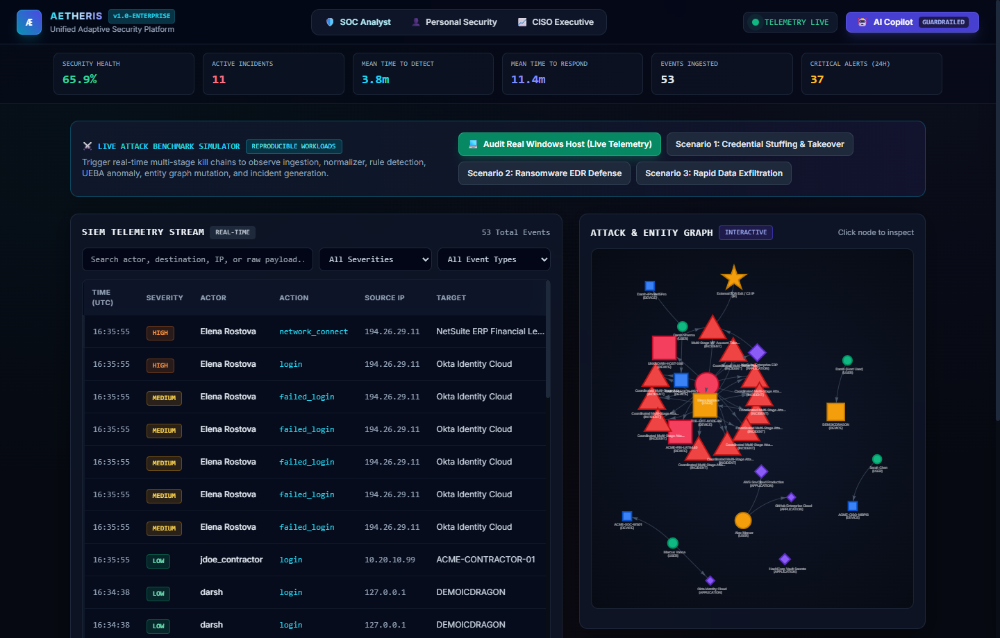
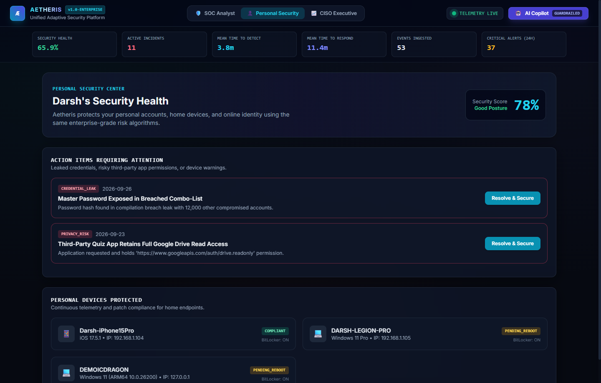
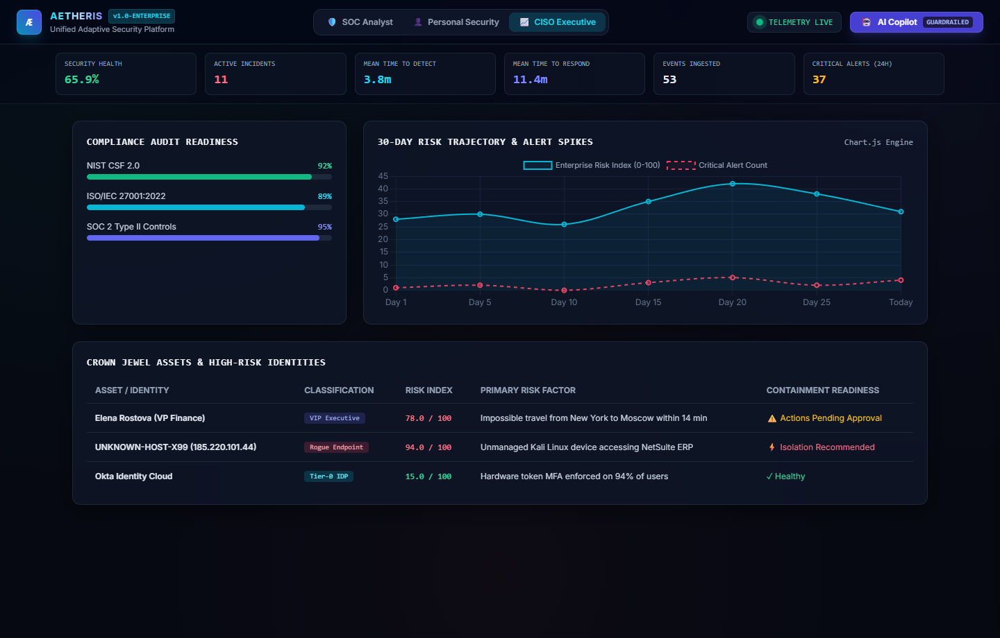
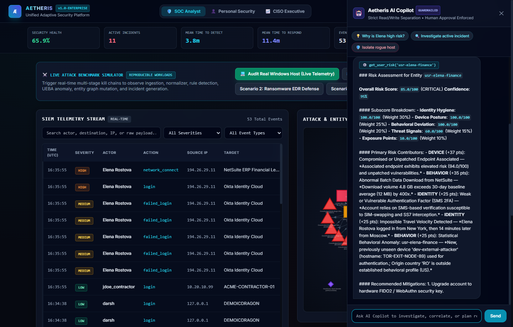
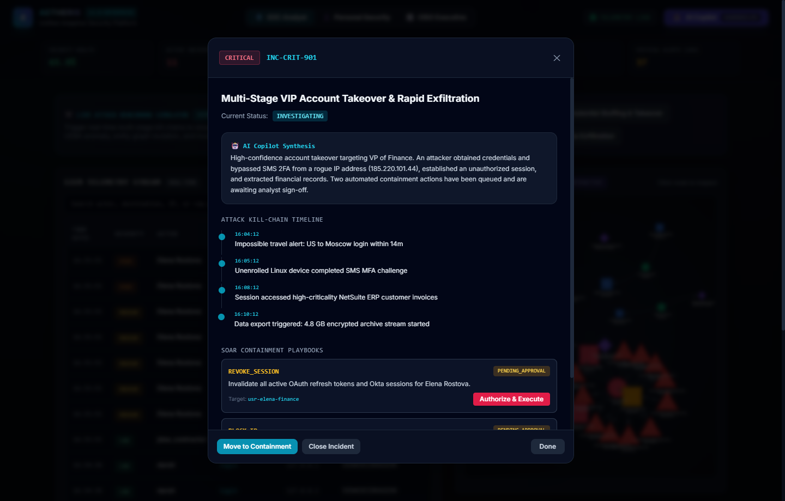

# Aetheris — Unified Adaptive Security Platform
> **Enterprise-grade security architecture with an integrated personal-security mode built on the same core engine.**

[](https://www.python.org/)
[](https://fastapi.tiangolo.com)
[](#architecture-overview)
[](LICENSE)

---

## 1. Architectural Vision

Modern security operations are plagued by fragmented point solutions, opaque risk scores ("black-box 78/100"), uncoordinated response actions, and ungrounded AI hallucinations.

**Aetheris** solves this through a unified architectural pipeline:
```
  [Data Sources] ──> [Normalizer / CEM] ──> [Real-Time Event Bus]
                                                    │
                ┌───────────────────────────────────┼────────────────────────────────────┐
                ▼                                   ▼                                    ▼
       [Rule Detection L1]               [Stateful Correlation L2]              [UEBA Anomaly L3]
                │                                   │                                    │
                └───────────────────────────────────┼────────────────────────────────────┘
                                                    ▼
                                          [Entity Graph Engine]
                                        (NetworkX Blast Radius)
                                                    ▼
                                         [Explainable Risk Model]
                                                    ▼
                                            [Incident & SOAR]
                                                    ▼
                                         [Guardrailed AI Copilot]
```

---

## 2. The Seven Architectural Planes

### Plane 1 — Data Collection & Ingestion
Ingests telemetry from disparate infrastructure without custom vendor code in detection layers:
- **Windows Security Logs** (Events 4624, 4625, 4688, Sysmon)
- **Cloud Infrastructure** (AWS CloudTrail, Azure Entra ID)
- **Network Gateways** (Palo Alto, Fortinet, Suricata)
- **Endpoint Telemetry** (Process trees, canary file modifications, living-off-the-land binaries)

### Plane 2 — Common Event Model (CEM / OCSF Aligned)
Normalizes all telemetry into a deterministic, queryable schema:
```json
{
  "event_id": "EVT-10002",
  "timestamp": "2026-09-28T21:40:00Z",
  "event_type": "authentication",
  "action": "login",
  "severity": "HIGH",
  "actor": { "id": "usr-elena-finance", "name": "Elena Rostova", "role": "VP of Finance" },
  "source": { "id": "dev-rogue-external", "hostname": "UNKNOWN-HOST-X99", "ip": "185.220.101.44", "country": "RU" },
  "destination": { "name": "Okta Identity Cloud" },
  "result": "success",
  "raw_source_vendor": "OktaSystemLog"
}
```

### Plane 3 — Three-Layer Threat Detection Engine
1. **Layer A — Deterministic Rules**:
   - `RULE-AUTH-001`: Brute Force / Credential Spraying ($\ge 5$ failures within 10 min window).
   - `RULE-IDP-004`: Impossible Travel velocity ($>600\text{ mph}$ geographical displacement).
   - `RULE-EDR-007`: Living-off-the-land malware patterns (`powershell -enc`, `vssadmin delete shadows`).
   - `RULE-NET-015`: Mass data exfiltration bursts ($>500\text{ MB}$ single egress pipe).
2. **Layer B — Stateful Multi-Stage Correlation**:
   - Maintains an in-memory entity trajectory window ($15\text{ mins}$).
   - Correlates multi-stage Kill Chains:
     $$\text{Password Failure} \longrightarrow \text{Password Success} \longrightarrow \text{New Rogue Device} \longrightarrow \text{High-Impact File Modification}$$
3. **Layer C — Behavioral Baselines & UEBA Anomaly Detection**:
   - Evaluates deviations from historical distributions:
     $$Z = \frac{|T_{\text{event}} - \mu_{\text{hours}}|}{\sigma_{\text{hours}}}$$
   - Penalizes novel device enrollments, foreign country origins, and abnormal data egress volumes.

### Plane 4 — Multi-Dimensional Explainable Risk Engine
Risk is not a mystery number. It is calculated dynamically across 5 dimensions:
$$\text{Risk} = \text{Clamp}_{0..100}\Big(0.30 \cdot \text{Identity} + 0.25 \cdot \text{Device} + 0.20 \cdot \text{Behavior} + 0.15 \cdot \text{Threat} + 0.10 \cdot \text{Exposure}\Big) \times \text{Confidence}$$

**Plain-English Explainability Output:**
> *"Overall risk increased from 24 → 78 because an unmanaged external device authenticated via SMS MFA outside normal working hours, followed by an impossible geographical displacement from New York to Moscow, and immediate access to sensitive NetSuite financial ledgers."*

### Plane 5 — Entity Graph & Blast Radius Analysis
Using `NetworkX`, Aetheris models relationships:
$$\text{User} \longleftrightarrow \text{Device} \longleftrightarrow \text{Account} \longleftrightarrow \text{IP} \longleftrightarrow \text{Application} \longleftrightarrow \text{Incident}$$
- Computes **Blast Radius**: reachable assets within $k$ hops if an entity is compromised.
- Visualized interactively with Vis.js.

### Plane 6 — Incident Engine & SOAR Automated Containment
- Formal incident state machine:
  $$\text{NEW} \longrightarrow \text{TRIAGED} \longrightarrow \text{INVESTIGATING} \longrightarrow \text{CONTAINMENT} \longrightarrow \text{CLOSED}$$
- Automated Playbooks:
  - `ISOLATE_HOST`: Isolates endpoint via EDR agent rules.
  - `REVOKE_SESSION`: Invalidates OAuth/SAML tokens across IDPs.
  - `BLOCK_IP`: Pushes perimeter firewall drop rules.
  - `ENFORCE_MFA`: Mandates hardware FIDO2 tokens.

### Plane 7 — Guardrailed AI Security Copilot
- **Strict Read/Write Separation**:
  - Read tools (`search_events`, `get_user_risk`, `calculate_blast_radius`) execute with grounded citations.
  - Write tools (`ISOLATE_HOST`, `LOCK_ACCOUNT`) enforce **Human-in-the-Loop Analyst Authorization**.
- **Adversarial Defenses**: Prompt-injection regex filtering and query parameterization.

---

## 3. Visual Proof of Content (Live System Screenshots)

> **Note**: These screenshots are authentic, unedited captures from the live platform executing on the physical Windows workstation. Detailed architectural breakdowns are documented in [**`PROOF_OF_CONTENT.md`**](PROOF_OF_CONTENT.md).

### 🛡️ SOC Analyst Mission Control & Attack Graph


### 👤 Personal Security Center (Dual-Mode Architecture)


### 📈 CISO Executive Posture & Compliance


### 🤖 Guardrailed AI Security Copilot


### ⚡ Incident Triage & SOAR Playbooks


---

## 4. Tri-Perspective UI/UX

1. **🛡️ SOC Analyst Mode**: Mission control, live WebSocket SIEM stream, Vis.js graph, incident triage, live local Windows host auditing, and 1-click live attack benchmark triggers.
2. **👤 Personal Security Mode**: Consumer-friendly health score (e.g., 78%), leaked password alerts, personal devices, and 1-click privacy remediation.
3. **📈 CISO Executive Mode**: Strategic posture, MTTD/MTTR KPIs, 30-day risk trajectory charts, and NIST/ISO/SOC2 compliance audit gauges.

---

## 5. Running the Platform

### Prerequisites
- Python 3.10+ (tested on Python 3.12)

### Quickstart
```bash
# 1. Install dependencies
pip install -r requirements.txt

# 2. Start Aetheris Platform
python run.py
```

Open your browser to:
- **Web Dashboard**: [http://127.0.0.1:8000](http://127.0.0.1:8000)
- **Interactive Swagger API Docs**: [http://127.0.0.1:8000/docs](http://127.0.0.1:8000/docs)
- **Live WebSocket Telemetry**: `ws://127.0.0.1:8000/ws/telemetry`

---

## 5. Live Attack Simulation Scenarios

From the SOC Analyst dashboard, click any of the 3 built-in scenario triggers:
1. **Scenario 1 — Credential Stuffing & Takeover**:
   - 5 failed login attempts $\rightarrow$ 1 success from Moscow TOR exit $\rightarrow$ NetSuite access.
   - Triggers Rule L1, UEBA L3, Correlation L2, and generates Incident `INC-CRIT-901`.
2. **Scenario 2 — Ransomware EDR Defense**:
   - Word spawns encoded PowerShell $\rightarrow$ executes `vssadmin delete shadows`.
   - Triggers EDR malware alert $\rightarrow$ prompts Host Isolation.
3. **Scenario 3 — Rapid Data Exfiltration**:
   - 1.2 GB egress stream to unrecognized C2 IP.
   - Triggers exfiltration alert $\rightarrow$ prompts perimeter firewall block.
